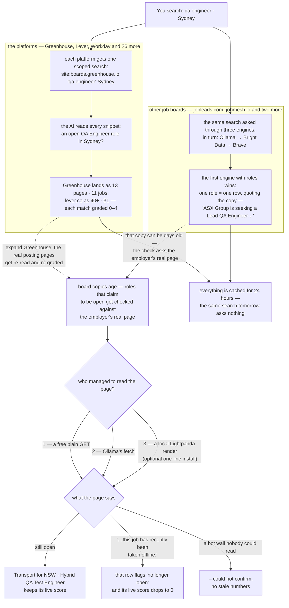

# ATS Search Tool

Local job-search command center: enter role keywords + optional location, see
**AI-graded matches across 29 ATS job-board platforms** on one page — links
open on Brave, and TypeSafe grades every match on four axes.

Runs 100% locally. Only leaves your machine: search queries to Brave/TypeSafe.


  

## Who is it for and use cases

Anyone job-hunting in Australia who suspects the good roles are not on Seek.
Built around one question: what is on the employer's own board right now?

- **Morning scan** — one search covers 29 boards, counts fill in live.
- **Hidden market** — government, university and niche boards that never sync to big platforms.
- **Freshness check** — expanding a row re-reads the actual posting pages: location, still-open, gone-flagged.
- **Niche roles** — boolean OR mode catches jobs big boards mislocate or never list.

## What

A one-page explorer for **direct-employer postings** — the obscure jobs that
Seek, LinkedIn and Indeed don't surface. Roles often live only on a company's
Applicant Tracking System (ATS): Greenhouse, Lever, Workday, government boards.
This tool runs one Brave `site:` search per platform, then expands any platform
row into a ranked match list.

### The whole flow on one picture



Each platform row shows:

| Column | Meaning |
| ------ | ------- |
| pages  | result pages for `site:<domain> <keywords>` (exact ≤ 60, then `60+`) |
| jobs   | matches the AI counts as real, open postings |
| row ↗  | ranked matches, each graded 0 (poor) to 4 (strong) on four axes |

Failures stay visible. Blocked or unreachable postings are labelled with the
reason (HTTP code, timeout, bot check) and expired postings are graded **gone** —
nothing quietly disappears.

## Why

Interesting roles get posted to a company ATS and never make it onto the big
boards, or arrive there weeks later in the wrong location. Re-checking 29
boards by hand every morning is slow. This page makes one search the only
task: type keywords, click Search, expand the rows that scored.

## Quick Start

```sh
# 1. keys
cp .env.example .env    # BRAVE_API_KEY for counts; TYPESAFE_API_KEY enables AI grading

# 2. run (Node >= 18, zero dependencies)
node server.mjs         # → http://localhost:8787
```

> **Note:** without a Typesafe key the tool still generates all platform
> links and raw page counts — grading simply stays off.

Free tier: 2,000 Brave queries/month, about 1–3 per platform per uncached
search (29 platforms ≈ 30–90 calls ≈ 30–60 uncached searches/month).

## How grading works

Two passes, both fed by Brave results and the posting pages themselves:

1. **Snippet pass** (one batched call per platform): every result is graded
   `rel` (keyword relevance) and `job` (is this an individual posting for an
   open role? `job ≥ 3` counts toward `jobs`).
2. **Verify pass** (when you expand a row): each promising match's posting
   page is fetched, stripped to text and re-graded for `loc` (location fit)
   and `live` (still live now?). A deterministic gone-check runs first:
   known ATS redirect patterns dead postings emit are recognized before the
   AI is even asked.

- Counts are cached 24h per (query, platform) — repeat searches are instant
  and free. `↻` on a row force-refreshes that platform and clears its verify
  cache.
- A separate AI score for keywords vs location is deliberate: run-to-run
  variance is ±0.3–0.5; scores are a signal, not a verdict.

<details>
<summary><strong>What do you need to be able to use it?</strong></summary>

Two keys in `.env` (copy `.env.example`):

- `BRAVE_API_KEY` — powers the counts (free tier: 2,000 queries/month) and
  the boards chain's last engine.
- `TYPESAFE_API_KEY` — powers the AI grading. Optional: without it you still get all platform links and raw page counts.

A third key is optional too:

- `OLLAMA_API_KEY` — powers the boards search's first engine and the Ollama
  fetch tier of the open-roles check. Any one of the three search keys turns
  the boards on; a config with none of them leaves the boards off, and the
  section's note names the keys that work.

A fourth key is optional too, and serves the same section:

- `BRIGHTDATA_SERP_API_KEY` — when Ollama is rate-limited or down, the second
  search falls back to Bright Data's SERP API, which serves Google's index
  (roles Ollama and Brave have not crawled). `BRIGHTDATA_SERP_ZONE` holds the
  zone name from your Bright Data dashboard (`serp_api1` by default). Without
  it a rate-limited Ollama just means that board search reports "did not
  answer" for the moment.

The grading engine is **JEV**, a scoring model from TypeSafe. It is not a
traditional LLM. It does not generate text, and it does not chat. You give it
your question and a piece of content; it returns a graded score.

A few real examples of how results get scored (search: `qa engineer, Sydney`):

| Result | What JEV decides | rel · job · loc · live |
| ------ | ---------------- | ---------------------- |
| `boards.greenhouse.io/acme/jobs/4192` "QA Engineer, Core, Sydney" | an individual posting for an open role, strong keyword and location fit | `3.6 · 3.5 · 3.0 · 3.5` |
| `acme.engineering/how-we-test` "How we test in 2025" | a blog post, not a hiring page, so it can rank pages but never counts as a job | `1.2 · 1.4 · – · 2.0` |
| `jobs.lever.co/bravo/2201` "QA Engineer, Melbourne" | right role, wrong city, so rel scores high but loc exposes the mismatch | `3.0 · 3.4 · 1.0 · 3.2` |
| any dead posting (page redirects to the board list) | gone-check fires first: live is forced to 0 and the row is flagged, without asking JEV | `3.5 · 4.0 · ✕ · 0.0` |

Scores 0–4 per axis; 0 (poor) to 4 (strong). `rel`, `job` and the first look at
`loc/live` come from the search snippet; expanding a row re-reads the actual
posting pages for the full grade.

**One scoring call, input and output.** The tool sends your search plus every
result of one platform in a single request, with two questions per result. For
`qa engineer, Sydney` and one Greenhouse result, the input is:

```json
{
  "state": {
    "keywords": "qa engineer",
    "location": "Sydney",
    "results": [{ "i": 0, "title": "QA Engineer, Core",
      "description": "Build test automation for our retail platform. Sydney, hybrid. Posted this week." }]
  },
  "model": "jev-latest",
  "questions": {
    "job0": {
      "type": "score",
      "instructions": "Is `results[0]` an individual job posting page for a currently open role? Judge by its title and snippet.",
      "criteria": ["Clearly not a job posting: blog post, category or board index…", "Probably not an individual job posting", "Unclear whether this page is an individual job posting", "Probably an individual job posting for a currently open role", "Clearly an individual job posting for a currently open role"]
    },
    "rel0": {
      "type": "score",
      "instructions": "How relevant is `results[0]` to a job seeker searching for `qa engineer`?",
      "criteria": ["Unrelated to the searched role", "Same broad field but a different role", "Partially relevant", "Relevant match", "Strong direct match"]
    }
  }
}
```

The output is only typed scores, no generated text, no reasoning to parse:

```json
{ "answers": { "job0": { "score": 4 }, "rel0": { "score": 3 } } }
```

`job0: 4` says the criteria line "Clearly an individual job posting for a
currently open role" fits. `rel0: 3` is "Relevant match" (a core QA Engineer
rather than, say, a Test Manager). The UI then maps each score to its color
bucket. One call per platform scores every result's every question in
parallel.

</details>

## Structure

```text
ats-search-tool/
├── server.mjs            # zero-dependency HTTP server: APIs, verify pass, page text
├── lib.mjs               # query building, paged Brave counting, the second
│                           search's engine chain, board-row parsing, the reader
│                           chain behind the gone-checks
├── index.html            # the whole UI (single file)
├── .env.example          # keys template
├── DESIGN.md             # design system (Ollama-derived monochrome)
├── PRODUCT.md            # product intent, register, principles
├── .blocks/              # reusable caveman-blocks scripts
└── agents/PROGRESS.md    # work log
```

## Platforms

29 defaults: 18 global ATS (Ashby, Greenhouse, Lever, iCIMS, Workday, BambooHR,
SmartRecruiters, JazzHR, Workable, Gem, Welcome to the Jungle, Teamtailor,
Recruitee, Breezy, Pinpoint, Homerun, …) plus 11 AU boards — state government
jobs boards (QLD/NSW/WA/TAS/NT), university PageUp boards (UniMelb, UNSW, ANU),
LiveHire, Employment Hero and EthicalJobs, each tagged with a region chip.

Some ATS hosts (NSW Jobs, LiveHire, UNSW, UniMelb) refuse scripted fetches;
their verify pass reports the exact failure instead of guessing.

## Other job boards

Some postings are newer than the search engine. A role posted four days ago on
a job board can sit there for a week before any index crawls it, and a plain
fetch of that page is usually refused by the board's bot protection.

With any one of the three search keys in `.env` (`OLLAMA_API_KEY`,
`BRIGHTDATA_SERP_API_KEY` or `BRAVE_API_KEY`), every search also asks four
job boards — jobmesh.io, jobflurry.com, thebigjobsite.com and jobleads.com —
through a second search index. The results land in an "Other job boards"
section below the platform rows:

- The page text comes back with the results, so a posting behind a bot wall is
  readable and its location and posting date can be scored.
- The same grading that scores a platform row scores these, with no extra
  model call and no extra tokens. The second search is a search, not a chat.
- One role is one row, even when it is listed on three boards. The row says
  which boards it was found on.
- A row that is a board's copy of a posting is marked "from a board copy", and
  a board's copy can lag the employer's own page — open the posting to check.
- The board round runs on the quota you give it: Ollama on your monthly
  Ollama Cloud quota, Bright Data per request, and a Brave-only config spends
  boards from its Brave account (a board search is a paged crawl — up to ~12
  Brave calls per search). The results are cached for 24 hours, so a repeated
  search asks nothing again.

The boards to ask are in `config.json` (gitignored) if you want to change them.
The defaults live in `lib.mjs`. The second search tries its providers in a
fallback chain: Ollama first, then Bright Data's Google index (with
`BRIGHTDATA_SERP_API_KEY`), then the same Brave channel the platform rows use.
An engine that comes back empty is walked past the same way: the posting is
asked of the next engine's index, and only when every configured engine has
found nothing does the board say so.

### Is the posting actually still open?

Board copies age. Roles that claim to be open are therefore checked against
the real posting page in the background (about six per search, the strongest
claims first). The section then reports, for example: "Checked 3 roles that
claim to be open: 2 are still open, 1 is closed, 0 we could not confirm."

- A page that states the role is gone ("no longer available", "taken
  offline"), or a real 404, flags the row **no longer open** and its live
  score drops to 0.
- A page no reader could fetch shows an em dash **–** in the live column:
  we are honest that we could not confirm it, rather than repeat a possibly
  stale board copy.
- The readers are tried in order: a free plain GET, then Ollama's fetch, then
  a local render with **Lightpanda** — a small headless browser that reads
  pages the scripted GETs cannot (bot walls). Lightpanda is optional; one
  line installs it and a wall page stops being a dash and starts being a
  verdict:

    `brew install lightpanda-io/browser/lightpanda-nightly`

  Without it every check still runs — plain GET answers many pages — but
  walled postings stay dash-marked instead of verified.

### Reading the row marks

- **muted score** — judged from the search snippet only (weak evidence)
- **✕** — that page refused the fetch (bot check); the reason is in the tooltip
- **–** — checked but the posting page could not be read, so no live verdict

## Features

- Full platform CRUD: add/edit/hide/remove + restore defaults (localStorage;
  server data always heals stale built-in entries)
- Boolean OR mode (comma-separated keyword variants), optional location
- Search history: last 50, click to re-run, clear
- Sort by `pages` or `jobs` (default: jobs); open-state preserved across sorts
- Open all in tabs (popup blockers may cap this — rows open individually)
- Reviewed marks: an ✓ checkbox per match ("n of N reviewed" per row) stored in the browser, keyed by URL — survives re-searches and refreshes

## Why no Bing/Google totals

Bing's HTML total ("About N results") was verified unreliable from scripted
HTTP: it ignored `site:`, returned unrelated pages (wikipedia, degree symbols),
and gave 65 → 6,570 for the same query across runs. Google needs JS + captchas.
So totals come from paging the Brave API you already trust.

## Blocks (reusable scripts)

```sh
caveman-blocks run brave-count --q 'site:jobs.lever.co "qa engineer" remote'
caveman-blocks verify brave-count   # needs BRAVE_API_KEY in .env or env
```

## Troubleshooting

- **"no Brave key" on rows** — add `BRAVE_API_KEY` to `.env`, restart server.
- **Grading missing** — no `TYPESAFE_API_KEY`; raw page counts still work.
- **✕ with "bot check"** — the ATS (or its CDN) refused scripted fetches; open
  the row's links in the browser instead.

## Roadmap (not built)

- Stop button for an in-flight search (the scan currently locks the page ~30s)
- Shareable URL state (keywords/location/sort survive reload)
- Suggested keywords + long-tail keywords via a cheap OpenRouter LLM


Design doc: `DESIGN.md` · Product: `PRODUCT.md` · Progress: `agents/PROGRESS.md`
